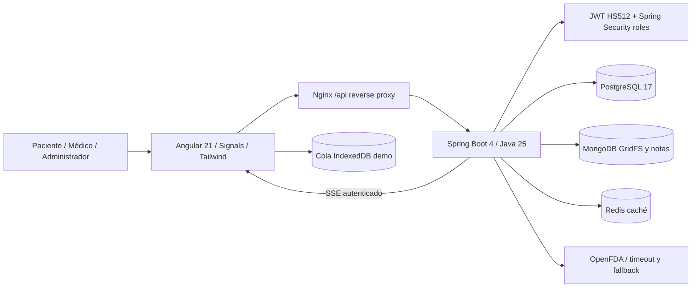
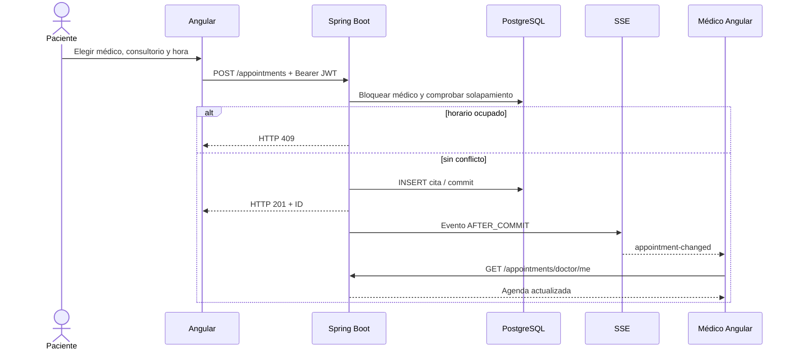
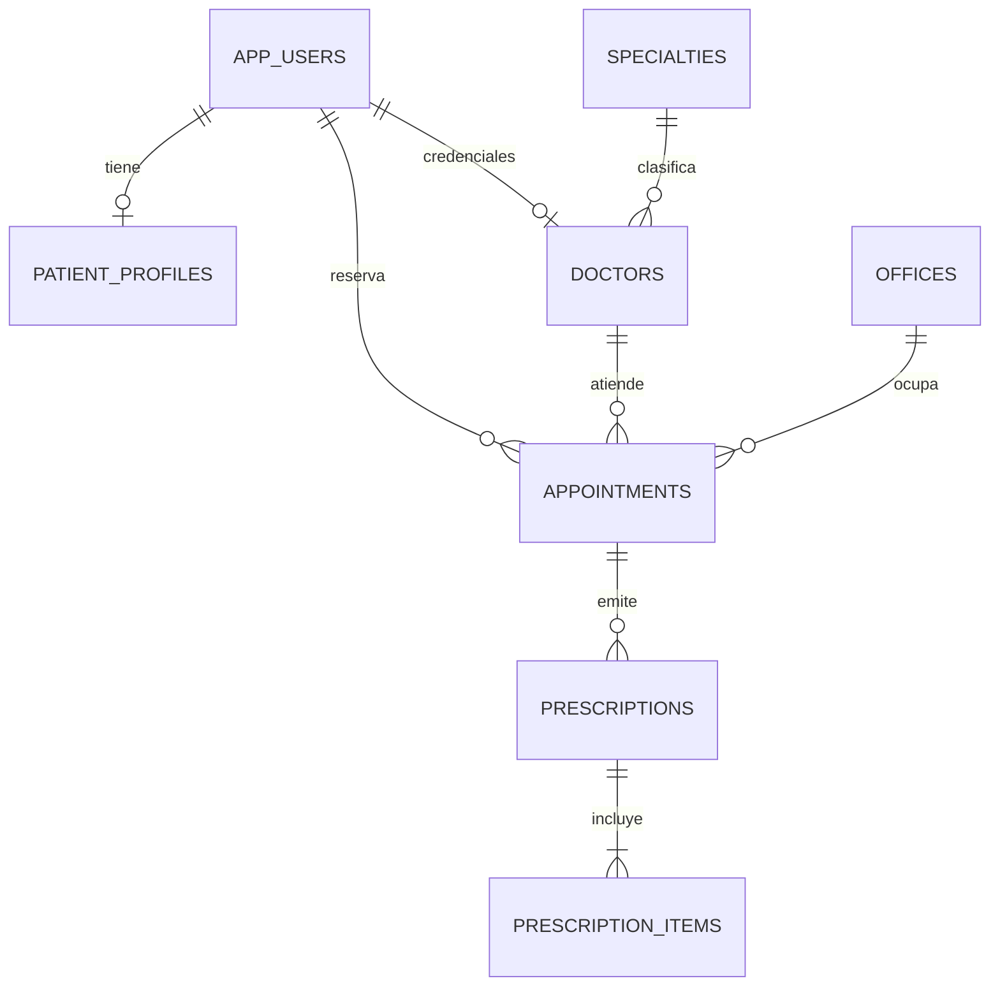

# MediConnect Pro — Arquitectura Full-Stack para defensa

## Vista de contenedores

## Flujo de una reserva

## Entidades relacionales

## Justificación

- **Backend REST modular (no una docena de microservicios):** un servicio único Spring Boot 4 organizado por dominios para una capstone manejable; entrega reglas transaccionales consistentes, roles y OpenAPI. Una evolución a microservicios requeriría límites de datos y trazabilidad distribuida.
- **PostgreSQL:** evita solapamiento al bloquear la fila del doctor y validar antes de insertar, con transacción de base.
- **MongoDB:** notas clínicas ficticias y ficheros de demostración GridFS; documento y binario sin inflar tablas relacionales.
- **Redis:** caches de catálogos y OpenFDA con TTL; no reemplaza a Postgres.
- **Angular Signals + zoneless:** estado visible sin dependencia de Zone.js; UI responsive con Tailwind.
- **SSE frente a WebSockets:** comunicación servidor→cliente suficiente para notificaciones de agenda, más simple que bidireccional. El cliente reconsulta la API segura; los eventos no incluyen notas ni datos del paciente.
- **Resiliencia:** OpenFDA con circuit breaker, timeout y validación manual requerida; IndexedDB conserva subidas ficticias si se pierde internet. **Cola offline no cifrada ni PWA completa.**

## Seguridad / límites

- JWT se valida en Spring Security, no en el menú Angular; no se incluye en URLs SSE.
- Todos los endpoints de medios comprueban propiedad antes de descarga; 5MB, magic bytes, nosniff y attachment.
- **No desplegar con datos reales de pacientes** hasta cubrir cifrado en reposo, auditoría, antifraude, control de acceso clínico, secretos, backups, borrado y normas de protección de datos locales.
- El broadcaster SSE actual es **en memoria de una instancia**; para múltiples réplicas hace falta Redis Pub/Sub u otro bus.
- El Docker Compose local usa `ddl-auto=update`; cloud (nuevo DB) usa Flyway V1 + `validate`, con Testcontainers de integración.
- La infraestructura de nube se considera **preparada, no desplegada**, mientras falte URL pública comprobable.
